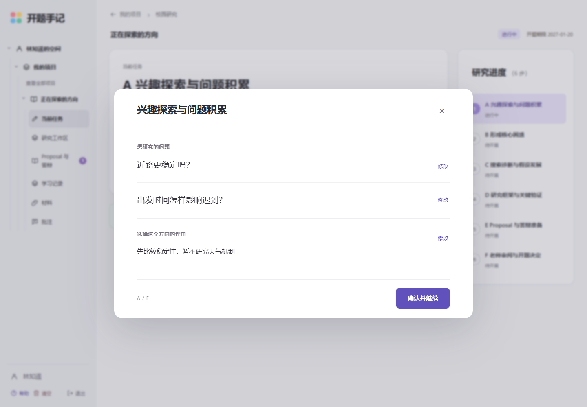
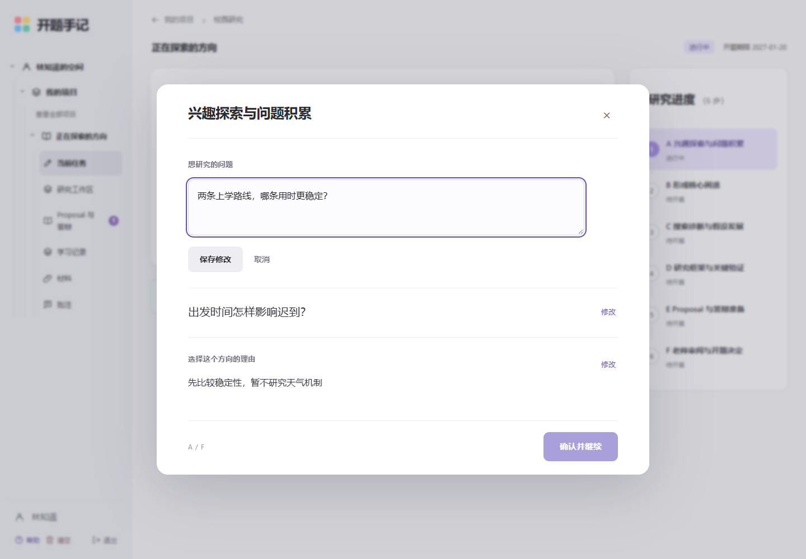
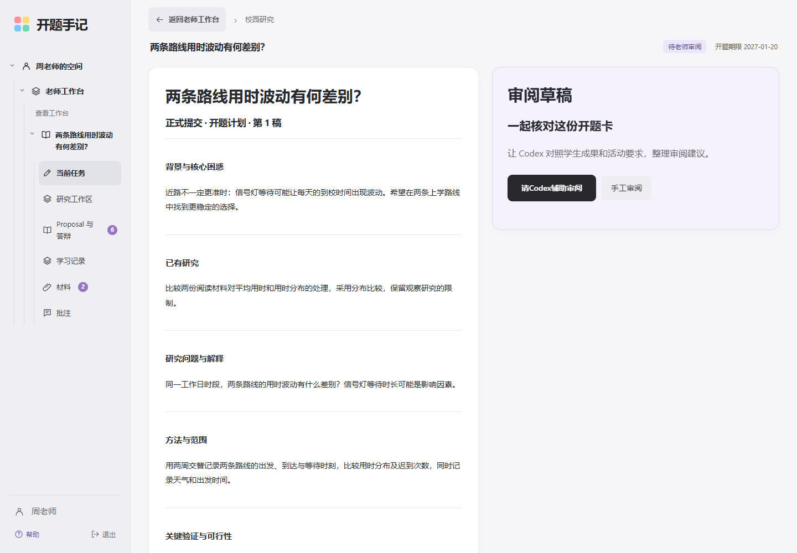

# 开题手记

## 设计思路与师生使用指南


开题手记做的事情很简单：帮学生把一个模糊的兴趣，一步一步变成能动手做的研究项目。学生在自己电脑的 Codex 里和 AI 讨论、干活；在网站上看任务、攒成果、收老师的反馈。老师主要用网站——看进度、查材料、做开题决定。


## 一、想解决什么问题

有个学生说，下午教室特别闷，想研究一下怎么回事。

观察挺好的，但从"想研究"到"能研究"之间还隔着一堆选择：是调查同学的主观感受，还是拿仪器量 CO₂？比较不同教室，还是比较同一间教室的不同开窗方式？能借到什么设备？能安排几次测量？

学生经常卡在这段路上。题目定得很大，能拿到的数据很少；查了几篇论文，说不清跟自己要做的事有什么关系；计划写得挺完整，真要动手才发现设备借不到、数据不够用。

老师这边也不轻松。同时带好几个学生，谁还在选题、谁该补文献、谁的小试出了状况、谁可以审了——判断这些，得能看到学生的东西和他们自己的理解，不能光听一句"我做完了"。

开题手记就是把这段过程理顺。做完之后，师生应该能清楚地回答四件事：

| 问题 | 要留下什么 |
| --- | --- |
| 准备研究什么 | 具体问题、研究对象和条件、为什么这样选 |
| 为什么值得做 | 跟已有研究的关系、准备补什么证据、拿来干什么 |
| 现有条件够不够 | 时间、资源、方法、小试结果和限制 |
| 下一步怎么开始 | 第一件正式任务——谁来做、什么时候交、交什么、怎么算完成 |

开题手记支持从老师发布要求到开题通过，最终形成可执行的研究计划和首项任务。

## 二、为什么这样设计

### 每一步都要落地，别白聊

讨论完了得留下东西。选题阶段留下问题和理由，文献阶段留下来源和比较，关键验证留下材料和解读——这些内容会逐步汇进同一份项目档案。

拿 CO₂ 那个项目来说，第一天可能只定了"研究同一间教室"，还没想好比哪两种开窗方式，这也能保存。下次接着来，AI 会读到上次的记录，从没做完的地方继续。只有满足阶段要求、成果确实存好了，网站上的进度才会往前走。

### 学生要说清楚"为什么"，AI 帮你把活干细

AI 能列候选问题、帮找资料、处理数据、写小结。但学生得讲出来自己的想法：为什么接受这个建议？手头有什么证据能支持什么判断？

比方说，选了"比较开窗方式"，学生可以说：我能借到记录仪，同一间教室就能测，所以先从可以量的东西入手。导师把讨论中的理由与原话一起保存，学生在网站核对内容，无需重复填写已有理由。这样老师就能看见学生是怎么从"教室闷"走到"比较两种开窗条件下 CO₂ 变化"的。

### 老师在关键节点作出判断

老师的活儿是发布要求、判断价值和可行性、做开题决定。AI 可以帮整理审阅建议，但证据要老师自己看、意见要老师自己改、发布得老师自己点。

CO₂ 那个项目，老师可能觉得题目跟校园生活确实有关联，但小试的测量记录还撑不起后面的方案。系统允许把这两个判断分开写，然后明确说还差什么。

### 新发现可以推翻旧计划

读了文献可能发现原来的题太大，小试完可能发现设备不好使，老师也可能要求补材料。流程允许回到相关阶段改，已有的记录不会丢。

比如小试忘了记开窗时刻——那就改记录表，补测一次。之前做的文献比较不用重来。但如果学生换了个完全不同的问题，就得重新检查哪些文献和判断还成立。

## 三、一个项目怎样走完

老师先发布共同要求，选好参与的学生。系统给每个学生建一个独立项目，各自存题目、进度、材料和意见。学生沿 A—F 六步推进。读到新证据时，可以回到相关问题重新讨论；完成准备后，由本人提交老师审阅。

| 阶段 | 要解决的事 | CO₂ 案例中的样子 |
| --- | --- | --- |
| A. 兴趣探索与问题积累 | 留住原话、问题和不同可能方向 | 从“下午教室闷”形成多个问法 |
| B. 形成核心 Problem | 说明问题如何连接、自己选什么 | 区分通风、人数与主观闷感的解释 |
| C. 搜索诊断与假设发展 | 记录检索改词，比较原文，提出有边界的RQ与解释 | 比较两篇独立来源，说明实际读到的范围 |
| D. 研究框架与关键验证 | 判断价值、方法、预算及关键未知项 | 小试核对CO₂记录与开窗时刻能否对齐 |
| E. 开题计划与答辩准备 | 核对七章节计划，回答实际追问 | 解释为什么这样比较、还能有什么解释 |
| F. 老师审阅与开题决定 | 本人提交固定版，老师正式决定 | 补证后形成新版本再提交 |

Problem 是一组问题背后的核心困惑；RQ 是准备通过研究具体回答的问题；Proposal 是提交老师审阅的开题计划。

关于文献比较，"两篇"是最低要求，可以多找；但两篇文章如果讲的是同一个实验，不算两份独立证据。每篇都要注明出处和相关原文位置，还要说清它支持了什么判断、哪些地方还缺证据。

研究范围以老师当前活动预算为准，默认值为26周：每周 6 个 45 分钟（含老师 30 分钟），合计学生 117 小时，其中自主时间 104 小时、老师指导 13 小时。学生要对照考试安排和设备窗口，算清楚实际能用多少时间。

老师审完之后，走向有三种：

| 结论 | 然后呢 |
| --- | --- |
| 可开题 | 约定年度验收依据和首项正式任务，项目正式启动 |
| 补证后再判 | 明确要补什么材料、谁来做、什么时候复核 |
| 调整方向 | 写清要改什么，学生回到相关阶段重新来 |

CO₂ 案例中，漏记了开窗时刻会影响数据怎么解读，老师可以让学生回到 D 补证。补完后核对受影响的问题和方法、更新 E 的开题计划与答辩，再由本人到 F 重新提交。

## 四、系统是怎么配合的

### 为什么是"网站 + 本地 Codex"

做研究的过程中，任务是不断变的。今天要一起读论文，明天要清理记录仪导出的表格，后天可能要写段分析代码或者调整试验模板。

**本地 Codex 的强项是结合资料讨论。** 导师按需搜索和查阅项目文件，包括个人笔记，帮助比较文献、核对数据，再保存观察、依据和草稿。重要选择由学生在网站确认。

**网站的强项是把事情理清楚。** 六个阶段的进度、完成标准、文献证据、开题计划、老师的反馈——都在固定的位置。老师能一眼看多个学生的情况，学生也知道自己做到哪了、下一步是什么。

两边各干各的擅长的事。Codex 管探索和动手，网站管组织和协作。师生通过同一份项目档案连在一起。

### 各部分怎么配合

- **Codex 深链接**由网站生成。点「打开 Codex」，就能在指定文件夹下打开聊天，看到预填指令。
- **插件里的 Skill**告诉 Codex 怎么辅导或审阅，比如怎样追问学生的选择、核对材料。
- **插件里的 MCP**让 Codex 读取网站上的任务和材料，把草稿和讨论原文存回网站。

```text
学生从当前任务打开 Codex，在课题文件夹对应的聊天里发送预填指令
          ↓
插件读取任务、已有成果和老师批注，Codex 按辅导 Skill 展开讨论
          ↓
插件保存成果草稿，同步讨论原文
          ↓
学生回网站核对成果，到 F 阶段提交固定稿
          ↓
老师在网站查看材料。需要辅助审阅时，打开 Codex 并发送预填指令
          ↓
老师回网站核对并发布意见，学生看到下一步
```

举个具体的：学生把小试的 CSV 放进项目文件夹，导师查阅记录，帮助核对时间和条件、讨论数据说明什么。AI直接保存查读与核算结果，说明依据和限制；需要改变研究方向或方法时，先形成候选供学生确认。老师在网站看到小试结论，点开对应材料核查。

有两点要注意。本地文件得关联或上传到项目，老师才能在网站看到。在聊天里说"做完了"不算数，得实际保存过，网站上才会更新。**正式进度以网站记录为准。**

## 五、学生怎么用

**第一次用。** 在电脑上安装并登录 Codex。登录开题手记，从讨论或辅助审阅入口下载 Research Coach。学生和老师用同一个插件，按网站实际使用的地址与电脑系统选包。详细步骤见[插件安装与使用](开题手记-插件安装与使用.md)。

解压安装包，运行「安装开题手记」。保持安装窗口打开，回网页点「我已有三位连接码」，核对姓名和身份，填入安装窗口里的码，再点「连接这台电脑」。安装完成后，如果 Codex 正开着，退出再打开。

### 1. 看清当前任务

用学生账号登录。只有一个项目时，会直接跳到「当前任务」。侧栏可以切换「研究工作区」「开题计划与答辩」「学习记录」「材料」和「批注」，点「查看全部项目」回到首页。

先看当前阶段的任务，按需展开「完成标准」和「老师的要求」。比如 CO₂ 项目的第一阶段，先留下真实观察和想追问的细节。可以先比较 2–3 个方向，试聊后再决定想继续哪个。

### 2. 跟 AI 导师聊

在「当前任务」点「跟AI教练开始讨论」。首次选目录时，点「选择文件夹」挑一个已有的课题目录，路径会自动填入。点「打开 Codex」，再发送网页预填的消息。

不用想太多怎么开口。比如可以说："我发现下午教室比较闷，想比较两种开窗方式，但还不知道要记什么。"然后跟着导师的追问往下聊就行。

继续时，从网站点「继续跟AI教练讨论」。同一阶段同一轮次可回原聊天。新阶段或新一轮补证可复用课题文件夹，在新聊天里接着用已保存的成果和老师批注。

换电脑、移动文件夹或找不到原聊天时，进入 Codex 的故障处理折叠项，点「更换课题文件夹」。选好目录后，需要接续旧内容时点「恢复本机讨论」。

### 3. 核对成果，继续下一步

导师会把观察、问题和候选方向存成草稿。准备好后，回网站点“核对阶段成果”，阅读本阶段最需要你确认的内容。

| 阶段 | 核对重点 |
| --- | --- |
| A | 想探索的问题，以及选择这个方向的理由 |
| B | 这些问题共同指向的核心困惑 |
| C | 研究问题、主要解释与可检验的预测 |
| D | 研究方法、关键验证、时间与资源 |
| E | 完整开题计划，以及答辩后需要修改的内容 |
| F | 准备提交老师的固定开题稿 |



*图 1　核对问题与选择理由；需要调整时点“修改”，全部核对好再确认继续。界面使用示例项目。*

某项内容不准确，点旁边的“修改”，写好后点“保存修改”。保存后仍留在本页，可以继续修改其他项，也可以再次修改已保存的内容。全部核对好，再点底部“确认并继续”。



*图 2　单项修改独立保存，完成核对后再推进阶段。*

如果页面提示文献比较或验证依据还没齐，先保存已经明确的选择，再点“继续讨论”。如果修改研究问题或方法影响了后面的判断，导师会帮助更新相关依据，其他成果继续保留。

D 阶段要想清楚三个问题：方法能回答研究问题吗？能区分不同解释吗？结论适用到哪里？需要老师判断时，可以点“请老师看一看”留下具体问题。

### 查看一个想法是怎样形成的

在“研究工作区”可以分别查看观察、问题、核心困惑、检索记录、假设和方法。点“形成过程”查看原话、历次修改与关联；“依据与选择”保留建议和本人的取舍，便于追溯判断。

点某项记录的“聚焦讨论”，可以围绕它继续研究。例如正在 C 阶段读文献，也可以回头检查核心困惑是否需要调整。

### 4. 材料放到找得着的地方

| 在哪看 | 看什么 | CO₂ 案例举例 |
| --- | --- | --- |
| 研究工作区 | 问题、方法、依据及形成过程 | 当前的问题定义和小试结论 |
| 开题计划与答辩 | 固定开题稿、答辩与提交状态 | 第几稿、回答过什么追问 |
| 学习记录 | 讨论记录和学习反馈 | 当初为什么选了比较开窗方式 |
| 材料 | 文献和上传的研究文件 | 论文、CSV 数据、现场记录、分析图 |
| 批注 | 老师意见和学生回应 | 老师让补记哪些条件 |
| 项目文件夹 | 本地的所有研究文件 | 修改记录模板、个人笔记 |

想知道讨论有没有传到网站，打开「学习记录」，看「最近完整原文回执」里的轮次和时间。插件关闭时暂停同步，下次启动会补传。

自己的补充写在项目目录的“我的笔记”中。导师可以按需搜索、只读查阅，并引用文件名和行号，不覆盖你的文字。文本、Markdown、CSV和Word正文可读；安装PDF支持后还可读取PDF文字层并定位物理页码，扫描页、图片和图形仍需另行核对。系统生成的阶段成果和对话文件会随档案刷新，因此个人补充不要直接写进自动导出文件。

导师也会记录哪些解释和练习对你有效。简单的查读、解释或核算可以直接提出，不必重新做一次选题讨论。

在"材料"页点"上传材料"来保存研究文件，然后在阶段成果里关联上。文件名要能认出来是什么、什么时候的，比如"第一次小试记录.csv""补测现场记录.md"。这样老师才能分清原始材料和后来补的。

### 5. 准备开题计划与答辩，提交审阅

E 阶段整理七部分内容：背景与核心困惑、已有研究、研究问题与解释、方法与范围、关键验证与可行性、限制与待判断、参考资料。每份开题稿引用当时确认的问题、方法和依据，后续修改不会覆盖旧稿。

和导师练习回答真实追问，例如：“为什么这样比较？”“还能有什么解释？”“这次小试能支持什么结论？”答辩记录来自你自己的回答，并对应正在核对的开题稿。

到 F，点“核对并提交老师审阅”，检查选定稿件，再点“提交老师”。提交成功后显示“等待老师审阅”，老师看到的是这次提交的固定版本。

### 6. 按要求补证

老师选择“补证后再判”时，当前任务会列出要补什么、谁负责、何时复核，以及回到哪个阶段。围绕这项要求继续讨论和补充材料，无关成果不用重做。

例如 CO₂ 小试漏记了开窗时刻，就回到 D 补齐现场记录和对应数据，解释新证据怎样影响原来的判断。上传材料后，核对修订后的方法和关键验证。

接着回到 E 更新开题稿，核对对应的答辩与修改；再到 F 检查新稿，由本人提交。看到“等待老师再次审阅”就说明重交成功。旧稿和老师原来的意见仍可查看。

通过开题后，看清首项任务、交付日期和完成标准，开始正式研究。下载研究资料包可保留开题稿、研究过程、依据和已上传附件；开题小试与后续正式研究结果分别记录。

## 六、老师怎么用

### 1. 发布要求

登录老师账号，在"老师工作台"右上角点"发布活动"。填活动名称、共同要求和成果标准、开题期限，勾上参与学生，点"发布给所选学生"。

比如发布一个"校园环境科研开题"活动，要求学生提出具体问题、比较文献、做关键条件小试、形成开题计划。共同要求所有参与学生都适用，每个人的研究项目是独立的。



*图 3　老师打开学生的固定提交稿，核对章节和对应版本。界面使用示例项目。*

### 2. 决定先看谁

工作台按状态分成四块："待审阅""等补证""进行中""已开题"。点顶部的数量卡可以筛选，活动下拉框可以只看某次活动的学生。

"待审阅"包括第一次提交的和补证后重新提交的。"等补证"用来跟进已经发出去的补证要求。"进行中"能看学生做到哪了，"已开题"能看约定的研究任务。

点进某个学生的项目后，结合固定开题稿、研究工作区、材料和学习记录来判断。比如学生交了一张 CO₂ 曲线图，就接着看原始数据、现场条件和学生自己的解释。页面顶部的"返回老师工作台"能回到列表，筛选条件不会丢。

### 3. 自己审，或让 Codex 帮忙

在待审阅的项目里，可以点「手工审阅」直接填写意见。想请 AI 帮忙，就点「请Codex辅助审阅」，填自己电脑上已有的审阅文件夹路径。点「打开 Codex」，核对并发送预填指令。插件会读取这次提交的固定稿、网站上的材料和讨论记录，把 Codex 整理的建议存成网页草稿。

回网站点「核对并发布草稿」，看过依据、改好意见后再发布。想继续追问，就点「继续辅助审阅」，回到这份稿件的原聊天。学生重交新稿后，辅助审阅会按新稿开启聊天。

看草稿的时候要留意：AI 会标出哪些材料是已经看过的、哪些附件还没解析。对于没看过的，自己决定要不要打开核查或让学生补。

### 4. 把意见写成学生能照着做的下一步

审阅表单先填"对研究价值的判断"和"对年度可行性的判断"，然后选结论：

| 结论 | 要写清什么 | CO₂ 案例怎么写 |
| --- | --- | --- |
| 可开题 | 年度验收依据、首项任务的交付物、标准、负责人、日期 | 交首批正式测量的原始数据、现场记录和初步图表 |
| 补证后再判 | 回到哪一步、补什么材料、谁来做、什么时候复核 | 回到 D 补开窗时刻，再核对 E 的新稿与答辩 |
| 调整方向 | 调整范围、理由和下一步要求 | 根据设备条件重新定比较范围，再核对相关证据 |

还没想好的可以"暂存草稿"。确认之后点"确认并发布"，学生才能看到。**AI 整理草稿和老师正式发布是两回事**——草稿是建议，发布才是决定。

### 5. 跟进补证

学生在补证期间，项目待在"等补证"里。补完重新提交后，项目回到"待审阅"，标着"补证后已重新提交"。看看新加的材料和改过的判断，再做决定。

网站在页面可见的时候会自动刷新，回到页面时也会同步。正在填表单时不会刷新，免得打断输入。想看最新列表可以手动点"刷新"。

CO₂ 项目复核的重点：新记录里的开窗时刻能不能对上数据的时间？学生有没有解释清楚原来的小试哪里不够？正式测量方案有没有根据补测结果修过？

## 七、用 CO₂ 案例过一遍完整流程

一个“下午教室闷”的观察，怎样变成老师可以审阅的计划？

| 环节 | 学生做什么 | AI 帮什么 | 留下什么 |
| --- | --- | --- | --- |
| 发布要求 | 读活动要求与时间安排 | 讨论时读取共同要求 | 每名学生的独立项目 |
| A 兴趣探索 | 说出教室闷的经历和想追问的事 | 追问条件，保留不同问法 | 原话、问题和探索理由 |
| B 核心困惑 | 区分通风、人数与主观感受 | 比较问题之间的联系和不同解释 | 本人确认的核心困惑 |
| C 搜索与假设 | 阅读独立来源，比较相关原文 | 帮找资料、改检索词、辨别证据 | 检索记录、研究问题与有边界的解释 |
| D 框架与验证 | 核实设备、时间，做关键小试 | 检查方法、竞争解释与结论边界 | 方法、预算、小试依据和待解决问题 |
| E 计划与答辩 | 核对计划，用自己的话回答追问 | 整理七章节开题稿，追问并记录修订 | 固定开题稿与对应答辩 |
| F 提交与审阅 | 本人提交固定稿 | 可辅助老师整理审阅建议 | 老师正式发布的决定 |
| D → E → F 补证 | 补记开窗时刻，解释数据，核对新稿与答辩后重交 | 对照老师要求更新受影响内容 | 新证据、新稿、对应答辩与复审意见 |
| 通过开题 | 明确接下来的正式任务 | 帮梳理记录要求 | 老师约定的首项交付 |

通过开题后，首项任务可以这样约定：

| 项目 | 示例 |
| --- | --- |
| 首项正式任务 | 按修订方案完成第一批两种开窗方式的记录 |
| 负责人 | 学生本人（设备借用由老师协助落实） |
| 交付日期 | 开题后下一次指导日（发布时填具体日期） |
| 交付物 | 原始数据、带时间的现场记录、初步图表和简短说明 |
| 完成标准 | 两种方式都有记录，时间能对上，遗漏和异常有说明，学生能解释图表和适用条件 |

到这一步，学生应该能说出来：下次去哪测、记什么、交什么文件。老师也能在项目档案里找到支撑这个安排的文献、小试结果和修改过程。
